# Dependency Graph (v5.3)

Tento soubor popisuje zavislosti mezi hlavni casti aplikace DVD Sledovani vyroby.

```mermaid
graph TD
    Browser[Uzivatel / Browser] --> Index[index.php]
    Browser --> Save[save_zapis.php]
    Browser --> API[api/*]
    Browser --> AdminCore[admin/*]

    Index --> Config[includes/config.php]
    Save --> Config
    API --> Config
    AdminCore --> Config

    AdminCore --> Layout[includes/layout.php]
    AdminCore --> LayoutEnd[includes/layout_end.php]
    Layout --> MainCss[assets/css/main.css]
    LayoutEnd --> MainJs[assets/js/main.js]

    Config --> LangLoader[includes/lang_loader.php]
    LangLoader --> LangCS[lang/cs.php]
    LangLoader --> LangEN[lang/en.php]
    LangLoader --> LangUK[lang/uk.php]

    Config --> DB[(MySQL: dvd_vyroba)]
    Config --> TraceDB[(MySQL: traceability2)]

    %% NOK System (v5.3 refactored)
    NokAdmin[admin/nok_kody.php] --> Config
    Index --> NokAdmin
    SaveZapis[save_zapis.php] --> NokAdmin
    ZapisEdit[admin/zapis_edit.php] --> NokAdmin
    NokAdmin --> NokMatrix[(nok_matrix_afo<br/>nok_kody)]

    %% Manual
    Manual[admin/manual.php] --> Config
    Manual --> LangCS
    Manual --> LangEN
    Manual --> LangUK

    %% Traceability
    TraceTerminal[admin/traceability_terminal.php] --> Config
    TraceShift[admin/traceability_shift.php] --> Config
    TraceRecords[admin/traceability_records.php] --> Config
    TraceReport[admin/traceability.php] --> Config
    TraceTV[admin/traceability_tv.php] --> Config
    TraceTV --> ApiTraceTV[api/traceability_tv_data.php]
    KioskLogin[admin/traceability_kiosk_login.php] --> Config
    KioskProject[admin/traceability_kiosk_project.php] --> Config
    KioskScan[admin/traceability_kiosk_scan.php] --> Config
    KioskScan --> ApiKiosk[api/traceability_kiosk_data.php]

    %% Workers and workplace master data
    WorkersAdmin[admin/pracovnici.php] --> Config
    WorkersAdmin --> WorkersState[uploads/tmp/sync_ikos_workers_state.json]
    WorkplaceAdmin[admin/pracovisite.php] --> Config
    WorkplaceApi[api/pracovisite.php] --> Config

    %% Rework module
    ReworkTerminal[admin/rework_terminal.php] --> Config
    ReworkReport[admin/rework_report.php] --> Config
    ReworkKioskLogin[admin/rework_kiosk_login.php] --> Config
    ReworkKioskForm[admin/rework_kiosk_form.php] --> Config
    ReworkAdmin[admin/rework_*] --> Config

    %% Serizovaci checklist
    Checklist[admin/serizovac_checklist.php] --> Config
    ChecklistCatalog[admin/serizovac_checklist_catalog.php] --> Config
    ChecklistEditor[admin/serizovac_editor.php] --> Config
    Checklist --> ChecklistHelper[includes/serizovac_checklist.php]

    %% Import/runtime
    ImportAdmin[admin/import.php] --> ImportRuntime[includes/import_runtime.php]
    ImportAdmin --> ImportPy[includes/import_excel.py]
    AutoImport[scripts/auto_import_dvd.php] --> ImportRuntime
    SyncDVD[scripts/sync_dvd_import.php] --> ImportRuntime
    SyncDVD --> DVDState[uploads/tmp/sync_dvd_state.json]
    ImportRuntime --> DB

    %% Sync scripts
    SyncTrace[scripts/sync_traceability.php] --> TraceDB
    SyncTrace --> TraceState[uploads/tmp/sync_traceability_state.json]
    SyncUsers[scripts/sync_traceability_users.php] --> TraceDB
    SyncUsers --> DB

    SyncIkos[scripts/sync_ikos_workers.php] --> DB
    SyncIkos --> IkosSource[uploads/export_ikos.txt]
    SyncIkos --> WorkersState

    %% Scheduler layer (Windows/Laragon)
    DvdScheduler[scripts/sync_dvd_import_scheduler.ps1] --> SyncDVD
    IkosScheduler[scripts/sync_ikos_workers_scheduler.ps1] --> SyncIkos

    %% Admin scripts/deploy
    ScriptsAdmin[admin/scripts.php] --> BackupDb[scripts/backup_db.php]
    ScriptsAdmin --> ReleaseCheck[scripts/release_check.php]
    ScriptsAdmin --> GitCli[git binary]
    ScriptsAdmin --> ProdRoot[C:/laragon/www]
    ScriptsAdmin --> ProdConfig[C:/laragon/www/includes/config.php]
    BackupDb --> DB
```

## Poznamky
- Primarni aplikacni databaze je `dvd_vyroba`, traceability data pouzivaji i `traceability2`.
- Synchronizace IKOS pracovniku je sjednocena na rezim `refresh_by_interni_id` (rucni i automaticka cesta).
- `admin/pracovnici.php` i `scripts/sync_ikos_workers.php` zapisuji stav do `uploads/tmp/sync_ikos_workers_state.json`.
- Importni tok pro DVD (`admin/import.php`, `scripts/auto_import_dvd.php`, `scripts/sync_dvd_import.php`) sdili `includes/import_runtime.php`.
- Scheduler skripty (`*.ps1`) jsou urcene pro Windows/Laragon provoz.
- **v5.3**: NOK systém refaktorován – tabulka `nok_afo_alias` odstraněna; `nok_kody_afo` přejmenována na `nok_matrix_afo`; automatická runtime migrace v `includes/config.php`.
- Deploy release workflow je integrovany do `admin/scripts.php` (superadmin-only), vcetne nasazeni tagu a prepisu `APP_URL` v produkcnim configu.
- `admin/manual.php` je role-aware manuálová stránka; texty čte výhradně z lang souborů přes `t('manual_*')` klíče.
- `includes/lang_loader.php` má fallback: při chybějícím DB klíči se sahá do `lang/{lang}.php`.
- Heslo Operátora (role `read`) se ukládá plain-text do `dvd_vyroba.users.traceability_card_code` a `traceability2.user.password` – porovnání 1:1 přes čtečku karet.
